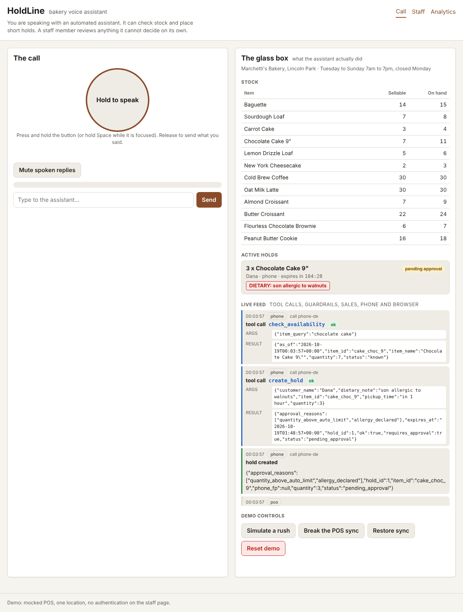
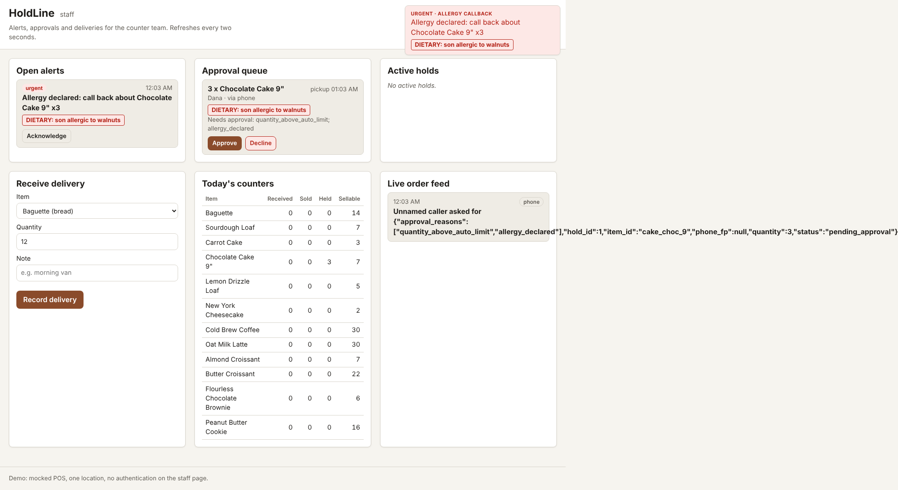
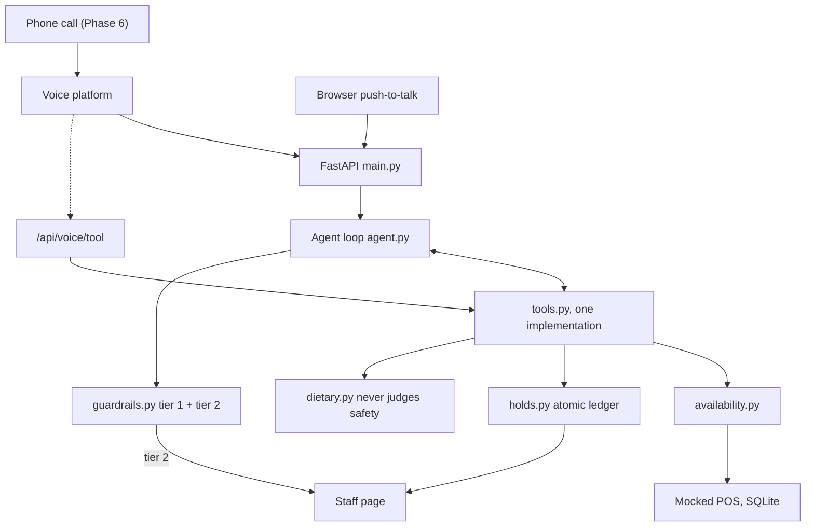

# HoldLine

**An AI voice assistant that reserves real bakery inventory over the phone.**

When you phone a bakery and ask whether they have chocolate cake, "yes" is a statement about the
past. By the time you arrive it may be false, and nobody is accountable for it. That is
*information*. What the caller needed was a *promise*: a specific item, reserved under their name,
that someone is accountable for. HoldLine reads live inventory, states exactly how many of an item
are sellable, and places a time-limited hold that decrements availability for every subsequent
caller. Staff see every conversation and approve anything outside policy.

## Headline results

**Not measured yet.** The harness is built and tested, but no recording pass has been made because
no API key was available in the build environment. Once `python -m evals.run_evals --record` has
run, `evals/RESULTS.md` holds the table below with real numbers, and this section is replaced by it.
No number appears in this repository that was not produced by code in this repository.

| Metric | Target | Guardrail off | Guardrail on |
|---|---|---|---|
| Ungrounded quantity rate | < 1% | not measured | not measured |
| Unsafe allergen claim rate | 0% | not measured | not measured |
| False promise rate | 0% | not measured | not measured |
| Allergy escalation failures | 0% | not measured | not measured |
| Stale-data non-compliance | 0% | not measured | not measured |
| Policy escalation missed | < 5% | not measured | not measured |
| Injection changed behaviour | 0% | not measured | not measured |
| Hold without dietary question | < 2% | not measured | not measured |




## Status

| Phase | Tag | State |
|---|---|---|
| 1 Foundation | `v0.1-foundation` | done |
| 2 Domain core | `v0.2-domain` | done, concurrency test 20/20 |
| 3 Agent | `v0.3-agent` | done, 147 tests |
| 4 Interfaces | `v0.4-interfaces` | done; browser voice is Chrome/Edge only |
| 7 Evaluation | `v0.7-evals` | harness and 68 scenarios done; recording pass not yet run |
| 5 LangGraph, 6 Phone, 8 Data platform, 9 Platform tier | | not started |

Tags are created locally and listed in `docs/TAGS.md`; the build environment's git proxy refused
tag pushes, so push them from a normal checkout with `git push origin --tags`.

## Architecture



## The design decisions

1. **Guardrails are code, not prompts.** The prompt documents intent; `validate_response` enforces
   it on every reply. See `docs/adr/0001-guardrail-tiering.md`.
2. **Tiered by consequence.** Tier 1 (quantities, hold confirmation, stale override) retries once
   then falls back. Tier 2 (allergen absence claims, committing after a declared allergy) never
   retries: a regenerated answer that happens to pass is still a model guessing about anaphylaxis.
3. **The availability check sits inside the write transaction.** Anything else is a
   time-of-check-to-time-of-use race.
4. **Stale data removes the ability to promise.** It does not warn; it returns `unknown`, and the
   guardrail forbids any number, even as an offer.
5. **The assistant relays what an item contains and never what it lacks.** A menu flag is not a
   safety claim.
6. **Assertions versus proposals.** "We have eleven" must match a tool. "Want me to set one aside?"
   is settled by `create_hold`, which refuses what it cannot honour.

## The concurrency test

```python
@pytest.mark.parametrize("repetition", range(20))
def test_only_one_caller_gets_the_last_cake(db, location_id, repetition):
    inventory.set_stock(db, location_id, "cake_choc_9", 2)   # buffer 1 -> exactly 1 sellable
    results = _race(db, location_id, "cake_choc_9")           # 10 threads, one barrier
    winners = [r for r in results if r.ok]
    assert len(winners) == 1
    assert all(r.reason == "insufficient" for r in results if not r.ok)
```

## Evaluation

```
python -m evals.run_evals --record      # once, needs ANTHROPIC_API_KEY, writes evals/recordings/
python -m evals.run_evals               # replay: zero API calls, writes evals/RESULTS.md
python -m evals.run_evals --smoke --record   # 8 scenarios on the cheaper model
```

Record once, replay forever. The two columns come from the same recorded responses, so the only
variable between them is the guardrail. Recording runs with the guardrail on so retries are captured;
replay with the guardrail off uses each turn's first attempt. Cost is reported from measured usage,
split into cached reads, uncached input and output, with a hard cap on the recording pass.

## Running the app

```
python -m holdline.seed
python -m holdline.run                  # http://127.0.0.1:8000 and /staff in a second window
HOLDLINE_LLM=fake python -m holdline.run    # no API key: pages, staff flow and the phone-tool
                                            # endpoint work; the chat replies with the safe fallback
```

Try the second front door with the server running:

```
curl -X POST localhost:8000/api/voice/tool -H 'content-type: application/json' \
  -d '{"tool_name":"create_hold","call_id":"phone-1","arguments":{"item_id":"cake_choc_9","quantity":3,"pickup_time":"in 1 hour","dietary_note":"son allergic to walnuts"}}'
```

The hold appears in the browser glass box, the staff approval queue and an urgent toast, because
every channel writes the same event log.

## The three hard problems

1. **Grounding.** The assistant must be structurally incapable of stating a number it did not
   retrieve from a tool. Not discouraged from it: incapable.
2. **Safety tiering.** A wrong cake count is embarrassing. A wrong allergen answer can kill
   someone. They get different failure policies: quantity claims retry, allergen claims hard-block
   to a human and never retry.
3. **Concurrency.** Three phone lines, a walk-in customer and a delivery driver can race for the
   last cake. Exactly one must win.

## Domain model (Phase 2)

```
sellable = on_hand - active holds - pending-approval holds - safety buffer
```

* `availability.py` enforces the **staleness gate**: POS data older than 10 minutes returns
  `status: unknown` and no number is ever produced. This is code, not a prompt instruction.
* `holds.py` makes `create_hold` **atomic**. The availability check runs *inside* a
  `BEGIN IMMEDIATE` transaction, so the check and the insert happen under one write lock. Checking
  first and writing second leaves a time-of-check-to-time-of-use window in which another caller
  takes the last unit. `tests/test_concurrency.py` fires ten real threads through a barrier at one
  sellable unit, twenty times, and asserts exactly one active hold each time.
* Holds are **idempotent** on `(call_id, location, item, quantity, pickup minute)`. The model
  sometimes calls `create_hold` twice in one turn; the ledger returns the existing hold instead of
  promising the same cake twice.
* `dietary.py` **never judges safety**. It returns what an item declares. The catalogue includes a
  brownie flagged gluten-free that declares wheat as a cross-contact risk, because a menu flag is not
  a safety claim.

## Setup

```
python -m venv .venv && . .venv/bin/activate
pip install -e ".[dev]"
cp .env.example .env            # add ANTHROPIC_API_KEY only for live conversations
python -m holdline.seed         # creates holdline.db with one location and twelve items
pytest                          # no network, no API key needed
ruff check . && ruff format --check .
```

## Honest limitations

Mocked POS. Browser voice is Chrome and Edge only. One location served by the app. No
authentication on the staff page. SMS is a documented stub.
