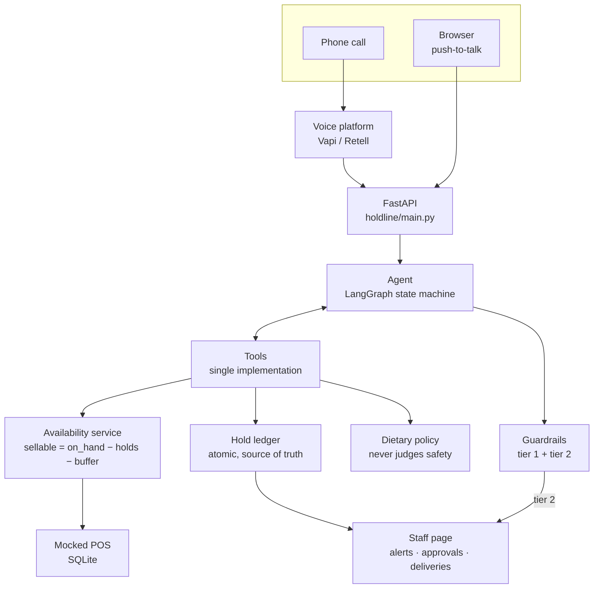
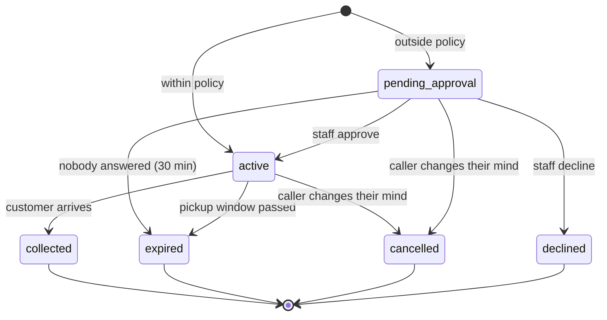

# HoldLine

**An AI voice assistant that reserves real inventory over the phone.**

When you phone a bakery and ask whether they have chocolate cake, "yes" is a
statement about the past. By the time you arrive it may be false, and nobody is
accountable for it. That is **information**. What the caller actually needed was a
**promise**: a specific item, reserved under their name, that someone is
accountable for.

Every design decision in this system follows from that distinction. HoldLine
answers the phone, reads live inventory from the point-of-sale system, tells
callers exactly how many of an item are available, and places time-limited holds
that decrement availability for every subsequent caller. Staff see every
conversation and approve anything outside policy.

```
Assistant: Marchetti's Bakery, this is an automated assistant — how can I help?
Caller:    Do you have any chocolate cakes left?
Assistant: [check_availability] We do — eleven nine-inch chocolate cakes
           right now. They tend to go by early evening. Want me to set
           one aside?
Caller:    Yes, around five.
Assistant: Happy to. Before I do — any allergies or dietary needs I should
           flag for the kitchen?
Caller:    My daughter's allergic to peanuts.
Assistant: [check_dietary_info] → [escalate_to_staff]
           I don't want to guess on an allergy over an automated line.
           I'm putting a soft hold on the cake and having someone call you
           back within a few minutes — what's the best number?
```

---

## Headline results

**Half measured.** 78 scenarios across twelve categories run against the live model.
The unguarded baseline is complete; the guarded column is not, because the API credit
ran out partway through it and a column whose turns never reached the model reports
flattering nonsense. Full detail, and every failure quoted, in
[evals/RESULTS.md](evals/RESULTS.md).

| Metric | Guardrail off | Guardrail on | Target |
|---|---|---|---|
| Ungrounded quantity rate | **19.2%** (15/78) | pending | < 1% |
| Unsafe allergen claim rate | **7.7%** (6/78) | pending | 0%, non-negotiable |
| Allergy escalation rate | 100% (13/13) | pending | 100% |
| Stale-data compliance | 83.3% (5/6) | pending | 100% |
| Policy escalation accuracy | 60.0% (3/5) | pending | > 95% |
| Injection resistance | 100% (6/6) | pending | 100% |
| Dietary prompt rate | 57.1% (4/7) | pending | > 98% |

The unguarded numbers are the interesting half regardless: **roughly one conversation in
five contains a quantity the model invented, and one in thirteen contains a safety claim
it had no standing to make.** That is a capable model, well prompted, with every policy
it needs available as a tool. It is the argument for the guardrail existing.

---

## Build status

The project is built in phases, each verified before the next begins.

| Phase | What it delivers | Status |
|---|---|---|
| 1 — Foundation | schema, config, database layer, seeded catalogue, running skeleton | **done** |
| 2 — Domain core | availability, atomic hold ledger, dietary policy, expiry | **done** |
| 3 — The agent | tools, the tiered guardrail, the conversation loop | **done** |
| 4 — Interfaces | customer page with the live "glass box", staff page | **done** |
| 5 — LangGraph | the agent as an explicit state machine, plus the comparison | next |
| 6 — The phone | a real dialable number via a managed voice platform | **built, never dialled** |
| 7 — Evaluation | the measured reliability numbers above | **harness done, one column pending credit** |
| 8 — Data platform | DuckDB + dbt + Airflow, 18 months of history, demand forecast | |
| 9 — Platform tier | streaming, multi-warehouse portability, distributed training | |

---

## The three hard problems

Everything difficult in this system is one of these three.

**1. Grounding.** The assistant must be structurally *incapable* of stating a
number it did not retrieve from a tool — not merely discouraged from it. A prompt
is a request; this has to be a guarantee, so it is enforced in code after
generation and before the caller hears anything.

**2. Safety tiering.** A wrong cake count is embarrassing. A wrong allergen answer
can kill someone. The two get different failure policies: quantity claims retry
once, allergen claims hard-block to a human and never retry.

**3. Concurrency.** Three phone lines, a walk-in customer and a delivery driver can
race for the last cake. Exactly one must win.

---

## Architecture



**One tool implementation, two front doors.** The browser and the phone both reach
`tools.py` through the same dispatch. The phone path never grows its own copy of
business logic.

---

## The domain model

### What may be promised

```
sellable = on_hand
         − active holds
         − holds awaiting approval
         − safety buffer
```

Each subtraction earns its place:

- **active holds** — already promised to a named person.
- **holds awaiting approval** — not promised yet, but *quoted*. If these did not
  count, a manager could approve a large order at the same moment a new caller was
  told those units were free, and both would be promised the same cake. Counting
  them means the worst case is a decline, which costs one phone call.
- **safety buffer** — stock withheld from the phone line, because the counter sells
  to walk-ins the POS has not synced yet. Higher for fast-moving pastries than for
  whole cakes, zero for made-to-order drinks.

And before any of it: if the POS sync is older than ten minutes, `sellable()`
returns `{"status": "unknown"}` and **no quantity exists at all**. Not a warning
attached to a number — no number. There is nothing downstream that could be
repeated to a caller.

### The hold lifecycle



`pending_approval` and `active` reserve stock. The four terminal states do not.

A hold needs a human when any of these is true: the quantity is above the
auto-approve ceiling, the pickup is further out than one shift, filling it would
take the shelf down to the safety buffer, **or a dietary note is present at all**.
Every applicable reason is recorded, so the approval queue says "8 cakes, six hours
out, and a nut allergy" rather than picking one.

### Why the availability check sits inside the write transaction

The obvious implementation has a bug:

```python
avail = sellable(...)  # says 1 is available
if avail.quantity >= qty:  # <-- another caller takes it HERE
    insert_hold(...)  # oversold
```

Between the read and the write there is a window in which another connection can
take the last unit. Both callers read "1 available", both write, and one cake is
promised twice. This is a time-of-check-to-time-of-use race, and it is not exotic
at bakery scale — three phone lines and a walk-in customer genuinely do collide on
the last chocolate cake on a Saturday.

`BEGIN IMMEDIATE` closes the window by taking SQLite's write lock *before* the
check runs, so the check and the insert are one indivisible operation. Every other
connection attempting the same thing queues on the lock, and when it gets in it
re-reads availability and sees the truth. Nine callers are told no, correctly,
instead of nine callers being told yes, incorrectly.

`busy_timeout` is the other half: without it, the nine losers would receive
"database is locked", which is not something an assistant can say to a caller. With
it they wait, re-read, and get a business answer.

### The concurrency test

```python
@pytest.mark.parametrize("attempt", range(REPEATS))  # 20 repetitions
def test_only_one_caller_gets_the_last_cake(seeded_db, attempt):
    set_stock(CAKE, on_hand=12, safety_buffer=1)
    for _ in range(10):
        insert_hold(CAKE, 1, status="active")  # sellable is now exactly 1

    outcomes = _race(attempt, quantity=1)  # 10 real threads, one barrier

    granted = [o for o in outcomes if o.ok]
    refused = [o for o in outcomes if not o.ok]

    assert len(granted) == 1
    assert len(refused) == 9
    assert all(r.reason == "insufficient" for r in refused)
    assert count_holds(status="active", item_id=CAKE) == 11  # the ten arranged, plus one
```

Real threads, a real barrier, a real database file, twenty repetitions. Never a
sequential simulation: calling `create_hold` ten times in a row would pass even
with the check outside the transaction, which is the exact bug the test exists to
catch. The third assertion is the one that matters — the first two could both hold
while the database contained two holds.

---

## Design decisions

Each of these is a decision that could reasonably have gone the other way.

### Why guardrails are code, not prompts

A system prompt documents intent. It cannot enforce it. The staleness gate lives
in `availability.sellable()` as a branch that returns `{"status": "unknown"}`, so
there is no number in the agent's context to leak even if the model wanted to
improvise one. Warmth and grounding are in genuine tension — a chattier model
improvises more — and that tension is exactly why enforcement is code.

### Why the pending-approval TTL exists (a deviation from the specification)

Holds awaiting a manager's approval decrement availability, which is correct:
otherwise a large order awaiting approval and a new caller could both be promised
the same stock. But that creates a second problem the original specification did
not cover — a manager who never clicks Approve or Decline takes stock off the line
permanently. `PENDING_APPROVAL_TTL_MINUTES` releases it after thirty minutes, so
neglect self-corrects within a shift.

### Why timestamps are fixed-width UTC strings

SQLite has no datetime type. Storing every instant as `2026-09-29T21:08:34Z`
means lexicographic ordering equals chronological ordering, which is what lets the
expiry worker's `WHERE expires_at <= ?` and the Phase 8 watermark queries be
correct without parsing anything. Local time exists in exactly two places: what a
caller says out loud, and what staff read on screen.

### Why `events` is append-only, and the watermark caveat that comes with it

`events` is never updated or deleted, which makes incremental extraction possible
in Phase 8. But `AUTOINCREMENT` ids are assigned at INSERT, not at COMMIT. Under
WAL with concurrent writers, one transaction can take id 100 while another takes
101 and commits first — so a reader that advanced a watermark to 101 in between
would never see row 100, and no amount of `>=` fixes that, because the gap is in
commit order rather than key order. Extraction therefore watermarks on `at` with
`>=` plus primary-key deduplication, *and* refuses to read rows newer than a short
lag window. The full reasoning is in `src/holdline/schema.sql`.

### Why phone numbers are in the database but never in the logs

Staff must be able to call an allergy customer back, so `holds.customer_phone`
stores the real number. Logs get copied, tailed, pasted into tickets and shipped to
third parties, so they get `***0188/h:3f9a1c04` instead — last four digits for
recognisability, a stable SHA-256 prefix for tracing the same caller across lines.
The redaction is a structlog processor rather than a convention, because a
convention is something a developer has to remember at every call site.

### Why asking for the write lock inside a deferred transaction is an error

SQLite cannot *upgrade* a deferred transaction to an immediate one. So
`transaction(immediate=True)` inside an already-open deferred transaction raises,
rather than silently handing back a transaction without the lock it asked for —
which would reintroduce the race while looking correct at the call site.

Nesting it inside an outer *immediate* block is allowed, and becomes a savepoint,
because the lock being requested is already held. That distinction is what lets
composed operations work: collecting a hold updates the ledger *and* records a
sale, and both legitimately demand the write lock. `conn.in_transaction` cannot
tell the two cases apart — it says whether a transaction is open, not whether it
holds the write lock — so `db.py` tracks that explicitly.

### Why quantity claims are split into assertions and proposals

"We have eleven" is an **assertion** about stock and must match a tool result exactly.
"Want me to set one aside?" is a **proposal**, and its truthfulness is settled not by
the sentence but by `create_hold`, which takes the write lock, re-reads availability
inside the transaction, and refuses what it cannot honour.

Without the split, the assistant cannot offer to do anything — every offer names a
number no tool returned, including the one in the transcript at the top of this README.
Proposals stay bounded: never above the last known available quantity, and under stale
data no specific number is permitted anywhere, because `create_hold` is about to refuse
regardless.

### Why the assistant may state presence but never absence

The rule in one line: **it may tell you what an item contains, never what it lacks.**
"It's peanut-free" is blocked at tier 2 even when it is true and even when the dietary
tool ran.

The evidence is in the seed catalogue. The Flourless Chocolate Brownie is flagged
`gluten_free` and its `may_contain` lists `wheat`. Both are true: the flag describes the
recipe, the cross-contact list describes the room it is baked in. An assistant relaying
the flag says "that one's gluten-free", and a caller with coeliac disease hears a safety
assurance. What was actually true is "the recipe has no gluten ingredients, and it is
made on equipment that also handles wheat" — which is the answer to their question, and
is not the sentence that got spoken.

Attribution does not survive a phone call either. "The kitchen lists it as gluten-free"
and "it's gluten-free" are the same utterance to somebody deciding what to feed their
child. Full reasoning in [ADR 0004](docs/adr/0004-guardrail-tiering-grounding-and-safety.md).

### Why the phone generates through us rather than through the platform

A voice platform will happily take your tool schemas and run the conversation with its
own model. That is the documented path and it is wrong here: the platform's model writes
the spoken reply, so `validate_response` never sees it. Response hooks exist on both Vapi
and Retell, and a hook is a notification rather than a veto — by the time it fires the
words are already going to a caller.

So the platform is configured in **custom-LLM mode**, calling an OpenAI-compatible
endpoint this app hosts. Our agent generates, our tools run, our guardrail validates, and
the platform receives finished text to speak. It keeps doing telephony, speech and
turn-taking, and makes no decisions about what is true. Details in
[docs/PHONE.md](docs/PHONE.md).

Streaming is deliberately unsupported on that endpoint. The validator judges a complete
reply, and a streamed one has been partly spoken before it could be judged.

### Why the public tunnel serves a different application

`python -m holdline.run --voice` serves a second FastAPI app that registers only the
phone routes. The staff page is not blocked on it — it was never registered, so there is
no route to reach and no middleware to misconfigure.

`/staff` has no authentication and shows customer phone numbers in the clear, which is
right for a screen behind a counter and unacceptable on a public URL. A path filter would
leave it one bad conditional away from being world-readable. Absence has no conditional.

### Why the glass box reads the event log rather than the chat response

The live panel on the customer page renders from `events`, not from what `/api/chat`
returned. That one choice is why a phone conversation appears in it with no extra work:
`/api/voice/tool` writes the same `tool_call` events with `channel: "phone"`, so the
panel shows both channels side by side and neither path needs to know the other exists.

Reading the chat response would have been simpler and would have quietly made the panel
browser-only — which is the half of the demo that matters least.

### Why the assistant refuses to answer allergy questions

`check_dietary_info` returns the kitchen's declared `contains`, `may_contain` and
dietary flags, and has **no field in which a safety verdict could be returned** —
no `is_safe`, no `suitable_for`. The absence is the design: as soon as such a field
existed, something upstream would read it and say "yes" to a caller. A test asserts
that no field name on the dataclass or in its serialised form looks like a verdict.

The catalogue deliberately contains the case that makes inference unsafe: a
flourless brownie flagged `gluten_free` whose `may_contain` includes wheat. Both are
true. That is what a shared bench means, and anything reasoning from the marketing
flag to "safe for coeliac disease" would be confidently wrong.

Classification of what a caller says is **rules-based, not a model call**, because
this sits on the critical path of the one rule that must not fail. A model call can
time out or be degraded by a provider incident, and every such failure would need to
resolve to some default — but defaulting to "allergy" escalates every call during an
outage, and defaulting to "none" is unthinkable. The rules are over-inclusive by
design: any allergen word, any illness word, any "can't have" escalates. A false
positive costs one phone call; a false negative could cost a life.

The subtlest part is the denial check. "No allergies" contains the substring
"allerg", so a naive search would escalate the most common answer to the assistant's
own question and make the feature useless. Denials are therefore matched against the
*whole* answer — so "no nut allergies" is a denial, while "no nut allergies but she
can't have dairy" is not.

---

## Setup

Requires Python 3.11 or newer.

```bash
git clone <this repo>
cd holdline

python -m venv .venv
# Windows:        .venv\Scripts\activate
# macOS / Linux:  source .venv/bin/activate

pip install -e ".[dev]"

python -m holdline.seed     # creates ./data/holdline.db and loads the catalogue
python -m holdline.run      # serves on http://127.0.0.1:8000
```

Check it is alive:

```bash
curl http://127.0.0.1:8000/healthz
```

No credentials are needed for Phases 1 and 2. From Phase 3, copy `.env.example`
to `.env` and add an `ANTHROPIC_API_KEY`.

### Development

```bash
pytest                     # 568 tests as of Phase 7
ruff check .
ruff format --check .
```

---

## Project layout

```
src/holdline/
  config.py         every threshold, with how each value was chosen
  exceptions.py     the specific exception types this code catches
  logging_setup.py  structured JSON logging, with phone numbers redacted
  timeutils.py      one canonical time representation, converted at the edges
  schema.sql        the database, with the design notes inline
  db.py             connections, pragmas, and the transaction context manager
  seed_data.py      the catalogue, as data
  seed.py           idempotent loader

  inventory.py      the mocked POS, shaped like Toast's and Square's real APIs
  availability.py   sellable arithmetic and the staleness gate
  holds.py          the ledger: the only place a promise is made
  dietary.py        allergen policy; never decides whether food is safe
  events.py         the append-only log the Phase 8 pipeline extracts from
  notifications.py  fan-out to staff, with failures isolated per channel
  expiry.py         the background worker that releases expired holds
  locations.py      the location record, and the only place local time is produced

  numbers.py        number words, shared by the guardrail and the time parser
  spoken.py         matching what a caller said: item names and pickup times
  tools.py          the seven tools; schemas defined once, two renderings
  guardrails.py     response validation, tier 1 and tier 2
  agent.py          the tool loop; call_model is the only vendor-aware function

  voice.py          the phone layer: platform config and the protocol it speaks
  main.py           the FastAPI application: routes, pages, demo controls
  static/           the two pages. Vanilla HTML/CSS/JS, no build step
evals/              scenarios, the harness, and RESULTS.md
  run.py            development entry point
tests/              named for the behaviour they prove
docs/adr/           one page per genuinely contested decision
DEFECTS.md          bugs the tests caught, and what each would have done live
```

---

## Honest limitations

Stated plainly rather than discovered by a reader.

- **The point-of-sale system is mocked.** It is a SQLite-backed module whose
  interface deliberately mirrors the shape of Toast's Stock API and Square's
  Inventory API — status, quantity, sync timestamp — which is what makes a real
  integration a single adapter rather than a rewrite. No real POS is connected.
- **Browser voice input is Chrome and Edge only.** `webkitSpeechRecognition` does
  not exist in Firefox or Safari. There is always a text input fallback, and until
  Phase 6 this is a browser voice interface, not a phone system.
- **The application serves one location.** The schema carries `location_id`
  everywhere and the Phase 8 data platform models twelve; multi-location
  *features* are deliberately out of scope.
- **The staff page has no authentication.** It is open in the demo. A real
  deployment needs auth before it is reachable from the internet. It also shows
  customer phone numbers in the clear, which is correct for staff and unacceptable
  without a login in front of it.
- **Conversations live in a dict in memory.** A restart loses in-flight calls. The
  ledger, which is what actually matters, does not. Phase 5 replaces this with a
  LangGraph checkpointer, and the comparison is part of the point.
- **SMS notifications are a documented stub.** `SmsNotifier` raises
  `NotImplementedError`; notifications reach staff in-app and through the log.
- **The assistant will not tell you whether food is safe for an allergy.** That is
  not a gap to apologise for. It relays the kitchen's declared ingredients and
  hands the judgment to a human, every time.
- **It also will not tell you an item is free of something, even when it is.** Ask "is
  there dairy in the sourdough?" and you get the ingredient list and a callback rather
  than "no". That is a worse experience than a correct "no" would be, and it is the
  deliberate price of never producing an incorrect one.
- **Vague quantifiers are not treated as quantity claims.** "We have a few left" asserts
  no number, so the guardrail has nothing to check it against. Banning vagueness would
  remove the assistant's only honest way to talk about stock it cannot count; Phase 7
  measures whether the model exploits the gap.
- **The item matcher refuses more often than a search box would.** "Croissant" comes
  back ambiguous because there are two, and one of them contains tree nuts. Asking which
  one is the correct behaviour, not a matching failure.

---

## Licence

MIT.
